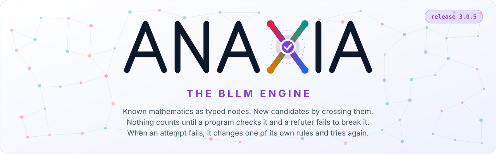
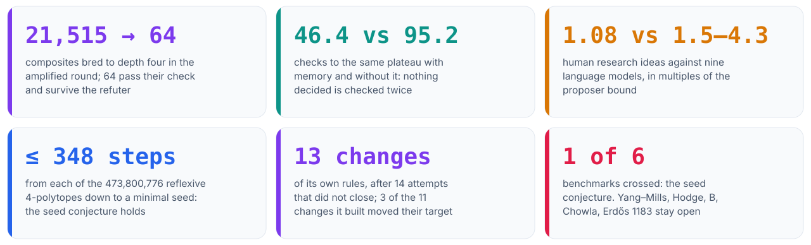
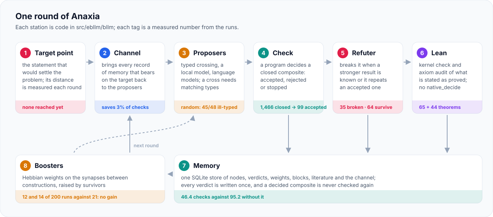
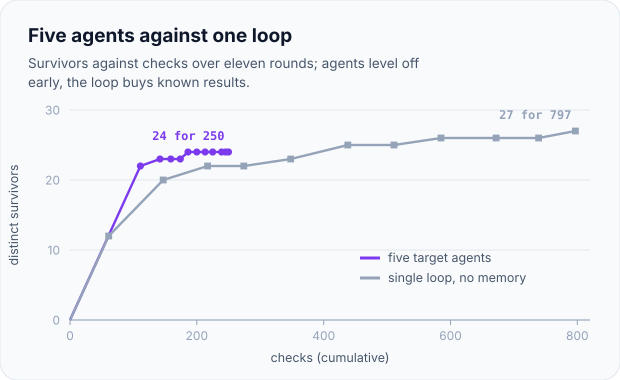
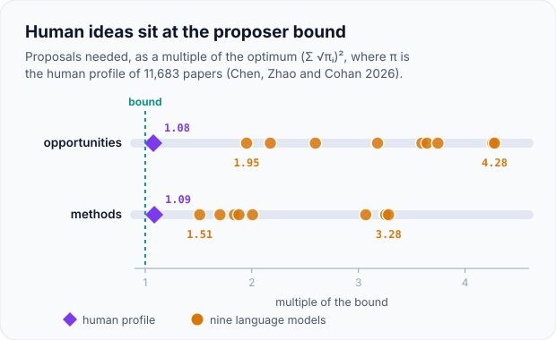

<p align="center">
  <picture>
    <source media="(prefers-color-scheme: dark)" srcset="docs/assets/anaxia-banner-dark.svg">
    
  </picture>
</p>

<p align="center">
  <a href="https://github.com/creelie/eBLLM/actions/workflows/ci.yml"></a>
  <a href="https://github.com/creelie/eBLLM/actions/workflows/package.yml"></a>
  
  
  <a href="https://github.com/creelie/eBLLM/pkgs/container/bllm-engine"></a>
  <a href="https://doi.org/10.5281/zenodo.23286641"></a>
  <a href="LICENSE"></a>
</p>

```sh
docker pull ghcr.io/creelie/bllm-engine:latest
docker run --rm ghcr.io/creelie/bllm-engine --version
docker run --rm -it --entrypoint bash ghcr.io/creelie/bllm-engine
```

<p align="center">
  <picture>
    <source media="(prefers-color-scheme: dark)" srcset="docs/assets/anaxia-numbers-dark.svg">
    
  </picture>
</p>

Anaxia does not guess at proofs. It holds the constructions that mathematicians have already
made, each typed by what it gives and what it needs, and it breeds new candidates by plugging the
output of one into an input of another. A candidate counts only when a program checks it, a
refuter fails to break it, and whatever is stated as proved goes through the Lean kernel. Every
verdict is written to memory, so the engine never pays twice for the same question. The numbers
above are its measured record, including the last one.

**Contents:** [The round](#the-round) · [Point it at a conjecture](#point-it-at-a-conjecture) ·
[Proved](#what-anaxia-has-proved) · [Measured](#what-the-runs-show) ·
[Not done](#what-it-has-not-done) · [Install and update](#install-and-update) ·
[Commands](#commands) · [Add a target](#add-a-target) · [The paper](#the-paper) ·
[Labels](#labels-of-the-recorded-results) · [Checks](#checks) ·
[Releases](#releases-and-the-closure-rule) · [Layout](#layout) · [Citing](#citing)

## The round

<p align="center">
  <picture>
    <source media="(prefers-color-scheme: dark)" srcset="docs/assets/anaxia-round-dark.svg">
    
  </picture>
</p>

A round starts from a **target point**, the one statement that would settle the problem, and ends
with its distance measured again. In between, the **channel** hands the proposers everything the
memory holds on that target, the **proposers** fill typed inputs, a **check** program decides each
closed composite, the **refuter** tries to break what was accepted, and **Lean** certifies what is
stated as proved. Verdicts go to **memory**; **boosters** reweight the synapses between
constructions for the next round. Every tag on the diagram is a measured number.

## Point it at a conjecture

The Hodge library holds the constructions of the Hodge papers and the literature around them.
Five crosses, each filling one typed input, take the reduction of (F2) to its lift from CM points
down to a closed composite, and the check says exactly what is missing:

```python
from ebllm.bllm import hodge as H
from ebllm.bllm.targets import cross

lib = {c.id: c for c in H.LIB}
c = lib["p.propagation"]                    # (F2) iff algebraicity lifts from CM points
for part in ["p.criterion", "p.product", "h8.markman", "p.cmpoint"]:
    c = cross(c, lib[part])                 # fill one typed input at a time
print(c.gives, sorted(c.needs))
r = H.check_hodge(c)
print(r.outcome, r.node)
print(r.statement)
```

```text
f2-lift []
stopped H.F2.lift
the product object has the polarised shape and Hankel rank 3, so the criterion asks dim Ext^2 = 57 at a CM point; this is the E_0^6 target, not yet met
```

The composite is well typed and closed, and it reaches the node of the target point, but it stops:
the semiregular object it needs does not exist yet. That is the shape of most of what Anaxia
returns on an open problem, a precise statement of the one missing input, recorded so that no later
round checks it again. `anaxia attack hodge` prints the open steps of the task, their ladders of
known cases, and the plan.

## What Anaxia has proved

The theorems of the paper, each with its Lean proof (Lean 4 with Mathlib, only `propext`,
`Classical.choice` and `Quot.sound`; the audit is `paper/bllm/lean/axioms.txt`).

| result | statement | proof |
|---|---|---|
| Entropy law | certifying self-modifications of total cost A with at most θ expected false acceptances costs (A/log ε⁻¹)(H(p) + log θ⁻¹), up to an additive A that cannot be lowered | <a href="paper/bllm/lean/BLLM/EntropyLaw.lean"></a> `entropy_lower`, `verification_lower` |
| Huffman schedules | for ε = 1/D and θ = D⁻ᵏ the sound schedules are prefix codes shifted by k, so the optimum is a Huffman code | <a href="paper/bllm/lean/BLLM/Kraft.lean"></a> `kraft_of_schedule`, `schedule_of_kraft`, `shifted_cost` |
| Rényi law | checks of polynomial order s cost A θ⁻ˢ e^{s H_α(p)} at the optimum, α = 1/(1+s) | <a href="paper/bllm/lean/BLLM/Renyi.lean"></a> `renyi_lower`, `renyi_attain` |
| Proposer bound | a proposer needs at least (Σ √πᵢ)² = e^{H½(π)} proposals in expectation, and square-root sampling attains it | <a href="paper/bllm/lean/BLLM/Gap.lean"></a> `search_lower`, `search_optimal` |
| Sound singularities | a sound infinite self-improvement of finite cost exists exactly when Σ aₙ log(1/aₙ) converges | <a href="paper/bllm/lean/BLLM/Singularity.lean"></a> `sound_schedule_iff` |
| False acceptances | finitely many almost surely exactly when Σ ε^{rₙ} converges | <a href="paper/bllm/lean/BLLM/Soundness.lean"></a> `false_accepts_finite`, `false_accepts_infinite` |
| Branching takeoff | a fixed false-acceptance rate, however small, makes the kept errors of an explosive takeoff diverge; amplified checks keep them finite | <a href="paper/bllm/lean/BLLM/Branching.lean"></a> `contamination_diverges`, `amplified_summable` |
| Gating | outcome gating costs (1−ρ)^{−(n−1)} times step gating with perfect checks | <a href="paper/bllm/lean/BLLM/Gating.lean"></a> `step_precision`, `separation` |
| Weak before strong | the optimal number of cheap checks before an expensive one, with matching bounds | <a href="paper/bllm/lean/BLLM/Agents.lean"></a> `cascade_lower`, `cascade_upper` |
| Lattice SU(2) gap | four-dimensional SU(2) lattice Yang–Mills has a mass gap for β_W < 1/3, and 1/3 is the ceiling of the method; not yet refereed |  finite parts in `lean/EBLLM/GaugeFix.lean` |

## What the runs show

<p align="center">
  <picture>
    <source media="(prefers-color-scheme: dark)" srcset="docs/assets/chart-amplified-dark.svg">
    
  </picture>
  <picture>
    <source media="(prefers-color-scheme: dark)" srcset="docs/assets/chart-memory-dark.svg">
    
  </picture>
</p>
<p align="center">
  <picture>
    <source media="(prefers-color-scheme: dark)" srcset="docs/assets/chart-agents-dark.svg">
    
  </picture>
  <picture>
    <source media="(prefers-color-scheme: dark)" srcset="docs/assets/chart-proposers-dark.svg">
    
  </picture>
</p>

- **Typing does the work.** Random pairing wastes 45 of 48 crosses on ill-typed pairs; only typed
  crossing reached the composite for the β_W < 1/3 gap, in every run.
- **Memory halves the cost** of reaching what the libraries can reach, and does not raise the
  plateau: every arm ends between 6.0 and 6.4 survivors, all of them known results.
- **Agents are cheaper and reach no further** than a single loop.
- **Human research ideas sit within 8% of the proposer bound**; nine language models need 1.5 to
  4.3 times the optimum number of proposals.
- **Hebbian boosters add nothing:** 12 and 14 of 200 runs reached the step, against 21 without
  them. The channel saves 3% of the checks.

Every chart is drawn by [`docs/assets/make_art.py`](docs/assets/make_art.py) from the data files of
the runs.

## What it has not done

<p align="center">
  <picture>
    <source media="(prefers-color-scheme: dark)" srcset="docs/assets/chart-hodge-dark.svg">
    
  </picture>
</p>

- It has solved none of its five benchmark problems: the Yang–Mills mass gap, the Hodge
  conjecture, Grothendieck's standard conjecture B, Chowla's conjecture and Erdős problem 1183.
  No pass line is crossed.
- It did not originate the step it is best known for. The composite for the β_W < 1/3 gap was
  first proposed by the language-model proposer and then entered in the library; the network
  reproduces it.
- Every survivor of the amplified round is a form of a range already proved, or (F2) in dimension
  at most five, which was known.
- The Hodge-only run of eleven rounds produced no survivor that was not already known and reached
  no target point (chart above).
- No result of the project is refereed, so every one of them is labelled CANDIDATE.

## Install and update

The image holds the installed package, the Lean library built with its pinned toolchain, the C and
C++ checks with a compiler, the agents and memory, the task suite and the experiments, with numpy,
python-sat and pyyaml. Julia and the GPU stack of `experiments/finetune` are not in it.

**It keeps itself current.** Every merge to `main` and every release rebuilds the image and
publishes it as `latest` and as the package version, after the version, the command line and the
Lean axiom audit pass inside the new image. A running image compares its own version, commit and
build time with those of `latest` and prints one line with the pull command when a newer one is
published. The check never blocks, stays silent offline, and is turned off by
`ANAXIA_NO_UPDATE_CHECK=1`.

```sh
docker run --rm ghcr.io/creelie/bllm-engine update   # this copy, the published one, and how to update
```

Without docker:

```sh
pip install git+https://github.com/creelie/eBLLM     # Python 3.9 or later, no dependencies
anaxia --version                                       # ebllm and python -m anaxia are the same
```

The Lean library needs [elan](https://github.com/leanprover/elan); `lean/lean-toolchain` pins
Lean 4.34.1 and the library uses Lean core only.

## Commands

```sh
anaxia tasks                 # stepwise records of solved and open problems (14 tasks)
anaxia attack hodge          # the open steps of a task, their ladders and the plan
anaxia controls              # closures, calibrations and open problems, with their labels
anaxia gap                   # the gap law on the human and language-model idea data
anaxia schedule 1,2,4        # the entropy-law schedule for given check costs
anaxia scan lean/            # Lean sources: sorry, axiom, native_decide, unsafe (comments ignored)
anaxia axioms audit.log 30   # only propext, Classical.choice and Quot.sound may appear
anaxia update                # whether a newer image is published
```

The continuous loops are `experiments/loop.py` (five problems) and `experiments/hodge_loop.py`
(Hodge only). [`docs/USAGE.md`](docs/USAGE.md) explains the spec format and the Python interface.

## Add a target

A target is a library of constructions, a check, a refuter and a target point.

```python
from ebllm.bllm.targets import Con, cross

criterion = Con("p.criterion", "hodge", gives="semiregular-object", needs=frozenset({"object"}))
product   = Con("p.product",   "hodge", gives="object",             needs=frozenset({"weil4"}))
cross(criterion, product)   # gives semiregular-object, now needs weil4
```

`cross(a, b)` fills one input of `a` with the output of `b` when the types match and returns
`None` otherwise. Write the check that decides a closed composite and the refuter that attacks an
accepted one, add the statement that would settle the problem to the agent's `TARGETS`, and the
agent joins the round. A closure enters the task suite as a JSON record with its Lean proof
(`src/ebllm/bllm/tasks/`).

## The paper

D. Bhattacharjee and U. Bhattacharya, *BLLM: The Entropy Cost of Sound Self-Improvement and a
Typed Crossing Network Tested on Five Open Problems*. Its source, its Lean development of 59
theorems and its checks are in [`paper/bllm/`](paper/bllm/), with their history from creelie/D7,
where it was first released (DOI [10.5281/zenodo.23449604](https://doi.org/10.5281/zenodo.23449604)).
The VSI circuit the package started from is Deep Bhattacharjee, *Synthetic Neuromorphic
Superintelligence for Verifier-Gated Conjecture Closure* (15 May 2026),
[`paper/VSI-verifier-gated-conjecture-closure-2026-05-15.pdf`](paper/VSI-verifier-gated-conjecture-closure-2026-05-15.pdf);
[`docs/REVIEW.md`](docs/REVIEW.md) reviews its numbered results, six of which are false as stated
with counterexamples proved in Lean, and [`docs/CIRCUIT-v1.1.md`](docs/CIRCUIT-v1.1.md) lists the
corrections the package implements.

## Labels of the recorded results

`anaxia controls` computes each label from the verifier factors stored in `src/ebllm/controls/`.
A result that has not been refereed is a CANDIDATE, however strong its formal evidence; open
problems are OPEN.

<details>
<summary>All 25 controls</summary>

| control | group | label | blocking verifiers |
|---|---|---|---|
| Graffiti.pc Conjectures 319, 352, 358, 359, 427 on domination (refuted) | closure | CANDIDATE | human |
| Tran's Conjecture 8.6 on regular Morley tetrahedra (refuted) | closure | CANDIDATE | human |
| Shankar's Conjecture 4.1 on even-intersecting lattice paths (proved) | closure | CANDIDATE | formal, human |
| Wang–Tian conjecture on tau_k-maximal graphs (proved) | closure | CANDIDATE | formal, human |
| Hou–Zhao Conjecture 4.10, Welch functions not third-order sum-free (proved) | closure | CANDIDATE | formal, human |
| Graffiti.pc / WOWII Conjecture 66, forest number (refuted) | closure | CANDIDATE | human |
| Densest packings of two translates of a lattice in R^4 (theorem; the 24-cell conjecture stays open) | partial | CANDIDATE | formal, human |
| Erdős Problem 1183: the lower bound of Theorem 1.4 | partial | CANDIDATE | human |
| Hodge conjecture for Fermat fourfolds of odd degree (Theorem F) | partial | CANDIDATE | formal, human |
| Blowup above alpha = 1/3 in viscous Katz–Pavlović dyadic models with small shell ratios | partial | CANDIDATE | formal, human |
| Lehmer's totient problem: a Lehmer number has at least 16 prime factors (partial result) | partial | CANDIDATE | formal, human |
| Fermat's Last Theorem | calibration | THEOREM | — |
| Kepler conjecture (sphere packing in dimension 3) | calibration | THEOREM | — |
| Navier–Stokes breakdown, alternatives (C) and (D) (OpenAI) | calibration | CANDIDATE | risk, human |
| Poincaré conjecture | calibration | THEOREM | — |
| Sphere packing in dimension 24 | calibration | THEOREM | — |
| Sphere packing in dimension 8 | calibration | THEOREM | — |
| Birch and Swinnerton-Dyer conjecture | open | OPEN | proof, formal, code, trace, sim, risk, lit, human |
| Collatz conjecture | open | OPEN | proof, formal, code, trace, sim, risk, lit, human |
| Densest packing in R^4 (D4 / 24-cell conjecture) | open | OPEN | proof, formal, code, trace, sim, risk, lit, human |
| Hodge conjecture | open | OPEN | proof, formal, code, trace, sim, risk, lit, human |
| Lehmer's totient problem | open | OPEN | proof, formal, code, trace, sim, risk, lit, human |
| P versus NP | open | OPEN | proof, formal, code, trace, sim, risk, lit, human |
| Riemann hypothesis | open | OPEN | proof, formal, code, trace, sim, risk, lit, human |
| Yang–Mills existence and mass gap | open | OPEN | proof, formal, code, trace, sim, risk, lit, human |

</details>

## Checks

`checks/run_all.sh` runs everything that CI runs:

- 65 Python tests (`tests/`), including the update check;
- `checks/c/sandtile.c`: the conservative two-site run does not stabilize in 10⁶ topplings, the
  dissipative run with absorbed share 1/N needs exactly N topplings for N up to 10⁴, and
  chip-firing is abelian on 200 random graphs;
- `checks/cpp/scope_playbook.cpp`: all 9,710 pairs of partial maps on at most three points, and
  4,340 playbook updates;
- `checks/julia/release_accuracy.jl`: all 2⁸ factor assignments of the release algebra, and
  Proposition 21.1 on 20,000 random steps;
- the Lean library: `lake build`, the source scan, the axiom audit of all 30 theorems
  (`lean/Audit.lean`), and an independent replay with `leanchecker --fresh`;
- the example run, whose label must be CANDIDATE with only the human factor blocking.

The paper's 55,271 numerical checks and its 59 Lean theorems run with
`bash paper/bllm/checks/run_all.sh`.

## Releases and the closure rule

A closure is finished only when the engine and the paper both carry it: the library and the task
suite get the construction with its Lean proof, a release rebuilds the image and is archived on
Zenodo with a version DOI, and the paper is rewritten as one text that carries the result in its
place. The same rewrite is due whenever enough new measured data would change what the paper
says. The steps are in [`RELEASING.md`](RELEASING.md).

## Layout

| path | contents |
|---|---|
| `src/ebllm/` | the circuit: obligations, verifiers, ledger, release algebra, controls, update check |
| `src/ebllm/bllm/` | the network: schedules, crossing, memory, targets, attack channel, agents, proposers, connectome selector, benchmark, tasks |
| `src/anaxia/` | the `anaxia` name of the same package |
| `lean/` | the circuit's Lean library (30 theorems, Lean core) |
| `paper/bllm/` | the paper, its Lean development (59 theorems, Mathlib) and its checks |
| `experiments/` | benchmark logs, the loops, the Hodge-only run, Erdős 1183 searches, the Yang–Mills scout, fine-tuning |
| `checks/` | Python, C, C++ and Julia checks |
| `docs/` | review, circuit v1.1, usage, artwork and the script that draws it |

[`HARDWARE.md`](HARDWARE.md) says what each component needs and [`DEVICE_RUN.md`](DEVICE_RUN.md)
which runs are meant for a larger machine.

## Citing

See [`CITATION.cff`](CITATION.cff). Each release is archived on Zenodo.

- v1.0.0: [10.5281/zenodo.23286642](https://doi.org/10.5281/zenodo.23286642)
- v2.0.0: [10.5281/zenodo.23455686](https://doi.org/10.5281/zenodo.23455686)
- v2.0.1: [10.5281/zenodo.23456124](https://doi.org/10.5281/zenodo.23456124)
- all versions (concept DOI): [10.5281/zenodo.23286641](https://doi.org/10.5281/zenodo.23286641)

## Licence

MIT, see [`LICENSE`](LICENSE). The papers in `paper/` are their authors' and are included for
reference.
